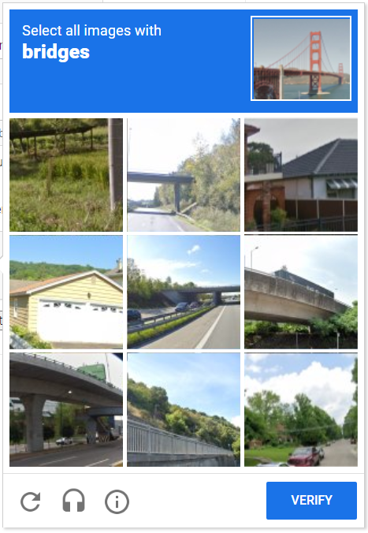
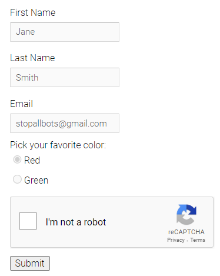
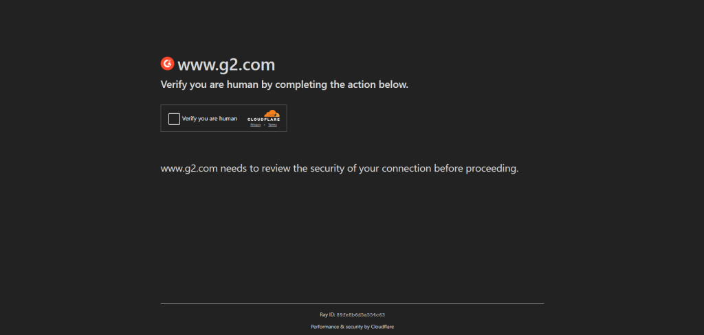
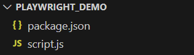
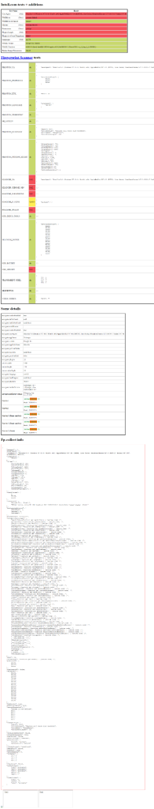
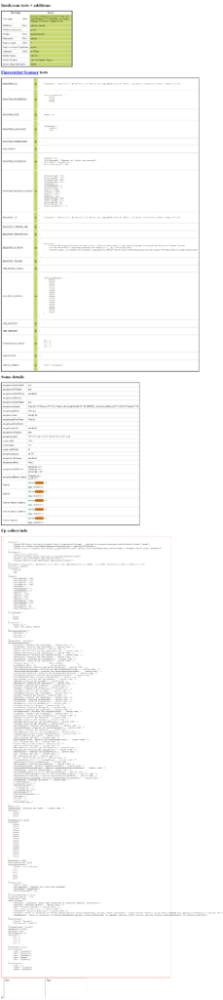

# 使用 Playwright 绕过 CAPTCHA

[](https://www.bright.cn/)

本指南介绍如何使用 Playwright 绕过 CAPTCHA，确保您的网页抓取任务顺畅运行、不中断：

- [什么是 CAPTCHA？能否绕过？](#什么是-captcha能否绕过)
- [Playwright 绕过 CAPTCHA：分步教程](#playwright-绕过-captcha分步教程)
  - [第 1 步：初始化 Node.js 项目](#第-1-步初始化-nodejs-项目)
  - [第 2 步：安装 Playwright Extra](#第-2-步安装-playwright-extra)
  - [第 3 步：设置 Playwright 脚本](#第-3-步设置-playwright-脚本)
  - [第 4 步：实现浏览器自动化逻辑](#第-4-步实现浏览器自动化逻辑)
  - [第 5 步：安装 Playwright Stealth 插件](#第-5-步安装-playwright-stealth-插件)
  - [第 6 步：注册 Stealth 设置](#第-6-步注册-stealth-设置)
  - [第 7 步：重复机器人检测测试](#第-7-步重复机器人检测测试)
- [如果 Playwright 的 CAPTCHA 解决方案无效怎么办？](#如果-playwright-的-captcha-解决方案无效怎么办)

## 什么是 CAPTCHA？能否绕过？

[CAPTCHA](https://www.bright.cn/blog/web-data/what-is-a-captcha)（“完全自动化的区分计算机和人类的图灵测试”）是一种用于区分人类用户与自动化机器人的测试。人类通常可以轻松完成，而机器应当觉得具有挑战性。



常见的 CAPTCHA 提供商包括 Google reCAPTCHA、hCaptcha 和 BotDetect。它们通常支持以下一种或多种类型：

- 图片类挑战：在图片网格中识别特定对象
- 文本类挑战：输入一串变形的字母与数字
- 音频类挑战：根据音频片段输入听到的词语
- 拼图类挑战：完成简单拼图，例如拖拽滑块到正确位置

CAPTCHA 也可能是某个特定用户流程的一部分，例如表单提交的最后一步：



在这些情况下，CAPTCHA 会始终显示，机器人无法绕过。不过，您可以集成 CAPTCHA 解决库自动处理，或使用由人工操作员实时解题的服务。

CAPTCHA 也常作为更广泛的反机器人方案的一部分，例如[Web 应用防火墙](https://www.cloudflare.com/learning/ddos/glossary/web-application-firewall-waf/)：



这类系统会在怀疑用户可能是机器人时动态显示 CAPTCHA。在这种情况下，通过让您的脚本更像人类行为，就有机会避开 CAPTCHA。

## Playwright 绕过 CAPTCHA：分步教程

一种高效的避免 CAPTCHA 的方法，是在自动化脚本中模拟人类行为，并使用更接近真实用户的浏览器“指纹”。[Playwright](https://playwright.dev/) 是领先的浏览器自动化库之一，非常适合此目的。

本教程将演示如何实现 Playwright 的 CAPTCHA 绕过逻辑。

### 第 1 步：初始化 Node.js 项目

如果您已经有 Playwright 的抓取或测试脚本，可跳过本步骤。否则，先为 Playwright CAPTCHA 项目创建文件夹并进入：

```bash
mkdir playwright_demo
cd playwright_demo
```

在其中初始化一个新的 Node.js 项目：

```bash
npm init -y
```

用您喜欢的 JavaScript IDE 打开项目文件夹，并新增一个 `script.js` 文件。



别忘了打开 `package.json`，通过添加 `"type": "module"` 将项目标记为 ESM 模块（module）。

### 第 2 步：安装 Playwright Extra

Playwright 原生不支持插件，社区用 [Playwright Extra](https://github.com/berstend/puppeteer-extra/tree/master/packages/playwright-extra#readme) 进行了补充。

将 `playwright` 和 [`playwright-extra`](https://www.npmjs.com/package/playwright-extra) 加入项目依赖：

```bash
npm i playwright playwright-extra
```

### 第 3 步：设置 Playwright 脚本

现在来初始化脚本，让 Playwright 能处理 CAPTCHA 挑战。先在 `script.js` 中从 `playwright-extra` 引入要控制的浏览器：

```js
import { chromium } from "playwright-extra"
```

再定义一个用于执行人类化交互的 [async](https://developer.mozilla.org/en-US/docs/Web/JavaScript/Reference/Statements/async_function) 函数：

```js
(async () => {
// set up the browser and launch it
const browser = await chromium.launch()

// open a new blank page
const page = await browser.newPage()

// browser automation logic...

// close the browser and release its resources
await browser.close()
})()
```

这段代码会启动一个新的 Chromium 实例，打开一个页面，然后关闭浏览器。

### 第 4 步：实现浏览器自动化逻辑

示例目标站点是 [bot.sannysoft.com](https://bot.sannysoft.com/)，它会在浏览器中运行多项测试，以判断访问者是人还是机器人。您在本机浏览器访问时应能看到全部测试通过。

使用 [`goto()`](https://playwright.dev/docs/api/class-page#page-goto) 连接到目标页面：

```js
await page.goto("https://bot.sannysoft.com/")
```

创建整页截图以查看反机器人测试的结果：

```js
await page.screenshot("results.png")
```

合并到完整的 `script.js`：

```js
import { chromium } from "playwright-extra"

(async () => {
// set up the browser and launch it
const browser = await chromium.launch()

// open a new blank page
const page = await browser.newPage()

// navigate to the target page
await page.goto("https://bot.sannysoft.com/")

// take a screenshot of the entire page
await page.screenshot({
path: "results.png",
fullPage: true
})

// close the browser and release its resources
await browser.close()
})()
```

在命令行运行：

```bash
node script.js
```

脚本会在无头模式下启动 Chromium、访问目标页面、截图，然后关闭浏览器。打开项目根目录下生成的 `results.png`，您会看到：



原生（vanilla）Playwright 的无头模式无法通过多项测试。接下来用 Stealth 插件改进。

### 第 5 步：安装 Playwright Stealth 插件

[Playwright Stealth](https://github.com/berstend/puppeteer-extra/tree/39248f1f5deeb21b1e7eb6ae07b8ef73f1231ab9/packages/puppeteer-extra-plugin-stealth) 是 `playwright-extra` 的一个防检测插件。它会覆盖多项配置，让浏览器实例看起来更自然，不像被 Playwright 控制。

该插件最初为 Puppeteer Extra 开发，但同样适用于 Playwright Extra。使用 npm 安装：

```bash
npm i puppeteer-extra-plugin-stealth
```

然后在 `script.js` 中引入：

```js
import StealthPlugin from "puppeteer-extra-plugin-stealth"
```

### 第 6 步：注册 Stealth 设置

要实现 Playwright 的 CAPTCHA 绕过逻辑，只需通过 `use()` 在 `playwright-extra` 中注册 Stealth 插件：

```js
chromium.use(StealthPlugin())
```

此后，Playwright 控制的浏览器将更接近真实用户浏览器的表现。

### 第 7 步：重复机器人检测测试

此时 `script.js` 应如下所示：

```js
import { chromium } from "playwright-extra"
import StealthPlugin from "puppeteer-extra-plugin-stealth"

(async () => {
// register the Stealth plugin
chromium.use(StealthPlugin())

// set up the browser and launch it
const browser = await chromium.launch()

// open a new blank page
const page = await browser.newPage()

// navigate to the target page
await page.goto("https://bot.sannysoft.com/")

// take a screenshot of the entire page
await page.screenshot({
path: "results.png",
fullPage: true
})

// close the browser and release its resources
await browser.close()
})()
```

再次运行脚本：

```bash
node script.js
```

再打开一次 `results.png`，您会看到所有机器人检测测试均已通过：



## 如果 Playwright 的 CAPTCHA 解决方案无效怎么办？

反机器人工具关注的重点不止浏览器设置，IP 信誉同样关键，单靠免费库无能为力。

对只需单击的简单 CAPTCHA，您可以使用 [`puppeteer-extra-plugin-recaptcha`](https://github.com/berstend/puppeteer-extra/tree/39248f1f5deeb21b1e7eb6ae07b8ef73f1231ab9/packages/puppeteer-extra-plugin-recaptcha) 插件。但在面对 Cloudflare 等更复杂方案时，需要更强大的能力。

如果您在寻找真正可用的 Playwright CAPTCHA 解决方案，试试 Bright Data 的[网页抓取解决方案](https://www.bright.cn/products/web-unlocker)。其具备专用的[CAPTCHA 解决功能](https://www.bright.cn/products/web-unlocker/captcha-solver)，可自动处理 reCAPTCHA、hCaptcha、Cloudflare Turnstile、AWS WAF Captcha 等多种类型。

立即注册，开启免费试用。
